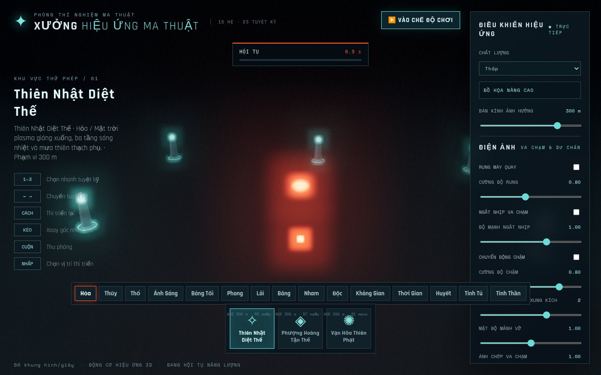
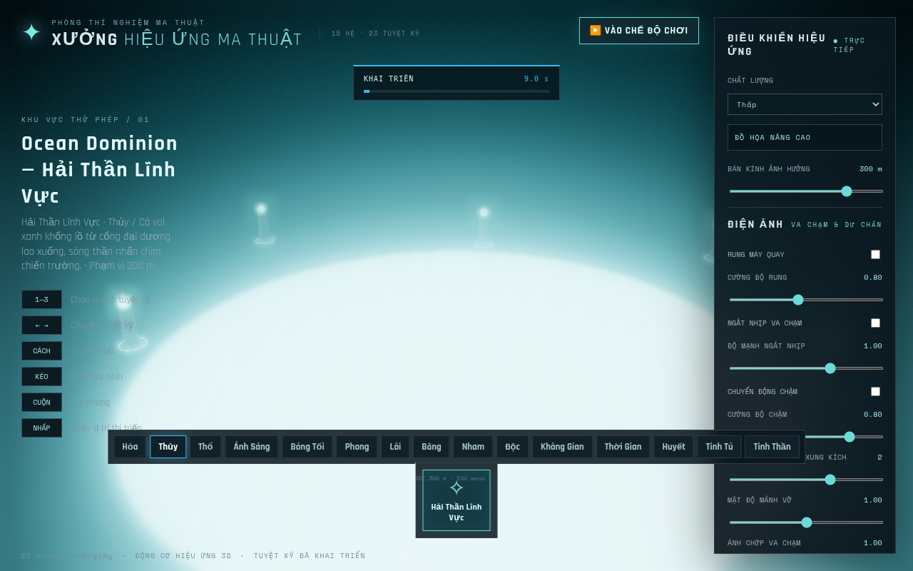
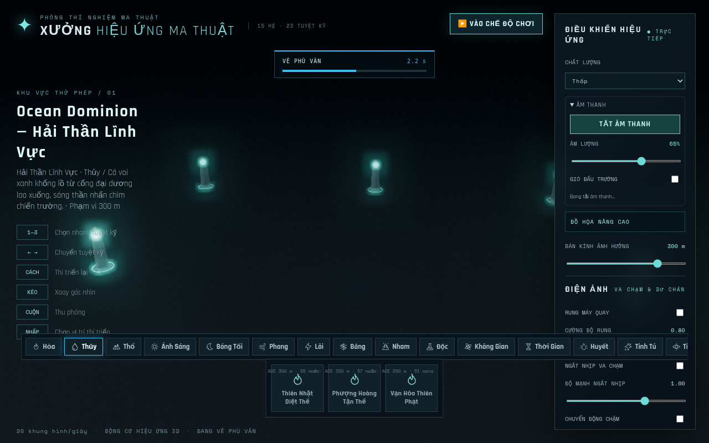

# Xem code, ảnh và video Magic-Game

## Code đã lưu

- [Draft PR #1](https://github.com/dinhquanhao/Magic-Game/pull/1)
- [Từng file thay đổi — Files changed](https://github.com/dinhquanhao/Magic-Game/pull/1/files); dùng bộ lọc `src/` để tập trung vào game, `tests/` để xem kiểm thử.
- [Lộ trình](../ROADMAP.md), [tiến độ](../PROGRESS.md), [báo cáo kỹ thuật](DEVELOPMENT-2026-10-17.md).

Nhánh `codex/magic-game-stability-vfx-20261017` chứa các checkpoint của phiên này. `main` không được merge hoặc bật auto-merge.

## Ảnh và video có thể truy cập

- [Tải video MP4](evidence/observation/preview.mp4) · [WebM gốc](evidence/observation/preview.webm)
- [Tải gói quan sát ZIP](evidence/observation.zip): giải nén rồi mở `observation/index.html` để xem video, ảnh và JSON cùng nhau. Nếu xem file trên GitHub, chọn **Raw / Download raw file** để tải.
- [Kết quả quan sát và console](evidence/observation/results.json): production bundle, 15 hệ, chọn/thi triển Thủy và Bóng Tối, Play Mode, mana và pause đạt; không lỗi console trong lượt ghi này.
- [Ảnh trước khi sửa mã trong phiên](evidence/before-session.png) · [ảnh sau — startup](evidence/observation/startup.png) · [ảnh sau — Play Mode](evidence/observation/play-mode.png).

Ảnh trước và sau được ghi tại các thời điểm mô phỏng khác nhau, không phải cặp so sánh chất lượng hình ảnh được chuẩn hóa. Video ghi thao tác UI và một phần timeline Thủy/Bóng Tối; không phải video hoàn chỉnh cả 23 tuyệt kỹ. Browser dùng SwiftShader, không dùng video để tuyên bố FPS trên GPU người chơi.





## Trạng thái Live Preview

**Chưa có Live Preview tương tác được xác nhận cho người dùng trong phiên này.** Máy chủ đã khởi động trong môi trường cloud và Playwright đã truy cập được qua localhost. Công cụ hiện có không xuất URL chuyển tiếp cổng có thể chia sẻ; `127.0.0.1` trong log là địa chỉ bên trong môi trường, không phải link web để mở trực tiếp từ máy của bạn.

Nếu giao diện Codex của bạn có bảng **Ports / Preview**, có thể chuyển tiếp cổng `4173` của máy chủ preview đang chạy. Khả năng chuyển tiếp và URL đó chưa được xác minh từ công cụ của phiên này, nên không ghi là đã hoạt động.

Để tương tác trên máy của bạn sau khi checkout nhánh PR:

```sh
npm ci
npm run build
npm run preview -- --host 127.0.0.1 --port 4173
```

Mở `http://127.0.0.1:4173` trên chính máy đã chạy các lệnh đó. Đây là cách chạy cục bộ, không triển khai web.

## Tự ghi artifacts cho mỗi nhóm thay đổi

Lệnh quan sát đã được xác minh trong môi trường Linux của phiên này; trên Windows có thể chạy trong WSL. Cần Python, thư viện trong `tests/requirements.txt` và Chromium. Runtime hiện tại đã có Chromium/ffmpeg. Máy khác có thể cài browser bằng `python -m playwright install chromium`; có thể chọn executable qua `PLAYWRIGHT_CHROMIUM_EXECUTABLE`.

```sh
python -m pip install -r tests/requirements.txt
npm run observe -- --label before-feature
# Chỉnh sửa nhóm thay đổi, chạy unit/regression phù hợp.
npm test
npm run observe -- --label after-feature
```

`npm run observe` tự build, mở Vite preview trên cổng 4180, mở Chromium, thao tác UI thật, chụp ảnh, ghi WebM và lưu console/result. Khi kết thúc, nó đóng browser và nhóm tiến trình server do nó tạo. Nếu cổng bị chiếm, nó báo lỗi thay vì dừng server khác. Lưu từng lượt ở `test-results/observations/<label>-<commit>-<UTC timestamp>/`; không ghi đè lượt cũ.

Tệp `results.json` ghi commit, trạng thái working tree, lỗi và tên video. Nếu encoder không có, báo rõ trong kết quả; không giả lập rằng đã có video. Gói artifacts chọn lọc được đưa vào `docs/evidence/`, cập nhật PROGRESS và push lên cùng nhánh PR sau mỗi nhóm. `test-results/` giữ bản ghi gốc cục bộ, không commit cache/browser.

## Phương án preview web riêng đã chuẩn bị

Đã có [`vercel.json`](../vercel.json) cho Vite (`npm ci`, `npm run build`, thư mục `dist`) và `.vercelignore` loại cache/artifacts khỏi deployment.

Vòng mới đã tìm được dự án Vercel `magic-game-preview` và status Vercel thành công trên GitHub cho checkpoint trước. Connector đọc project/deployment với scope team hiện trả **403**; chưa có CLI Vercel đã xác thực. Không tạo deployment trực tiếp, đổi audience/quyền hoặc gọi dịch vụ trả phí. Git push nhánh PR vẫn được thực hiện theo yêu cầu; Git integration hiện có có thể tự cập nhật Preview. Chỉ ghi là đã kiểm thử web khi có kết quả browser của đúng bản build.

[URL Preview do Vercel bot đăng trên PR](https://magic-game-preview-git-codex-magic-gam-593430-quuanghh2007-5227.vercel.app) là branch alias, có thể đổi theo commit. Chromium trong cloud bị `ERR_TUNNEL_CONNECTION_FAILED` khi mở URL này; hostname không nằm trong allowlist mạng. Connector cũng trả 403. Người dùng có thể thử mở URL bằng tài khoản Vercel của mình, nhưng chưa có kiểm thử game từ xa đạt trong phiên. Xem trạng thái đúng commit sau push ở PROGRESS.md; branch alias không tự chứng minh mã audio mới đã được deploy.


## Vòng audio và assets

- [Báo cáo, 12 ý tưởng được xếp hạng và giới hạn](ROUND-AUDIO-2026-10-17.md).
- [Bản nghe tham chiếu 15 hệ, 75 giây](evidence/audio/fifteen-elements.mp3) · [mốc từng hệ](evidence/audio/chapters.json).
- [Âm thanh thu thực từ WebAudio Chromium](evidence/audio/browser-audio.mp3) · [Opus/WebM gốc](evidence/audio/browser-audio.webm). Bản tham chiếu dùng gain riêng cho nghe thử; bản browser chứa master/spatial gain của game.
- [Video production MP4](evidence/audio/production-video.mp4) · [WebM](evidence/audio/production-video.webm). Video Playwright không có audio track; nghe audio bằng các file riêng bên trên, không coi chúng là video đã mux đồng bộ.
- [Gói audio/ảnh/video/báo cáo offline ZIP](evidence/audio-round.zip): tải, giải nén, mở `audio/index.html`. Trên GitHub dùng **Download raw file** để tải MP3/MP4/ZIP.
- [Matrix audio 23 skill](evidence/audio/matrix.json) · [Lifecycle/context recovery](evidence/audio/lifecycle.json) · [UI production cuối](evidence/audio/production-final.json).
- Ghi lại bằng `npm run observe -- --audio --label after-audio`. Để có tín hiệu PCM tự động kiểm chứng và bản ghi browser: `python tests/playwright_audio.py --url <URL-dev>`. Production không chứa globals kiểm thử.


