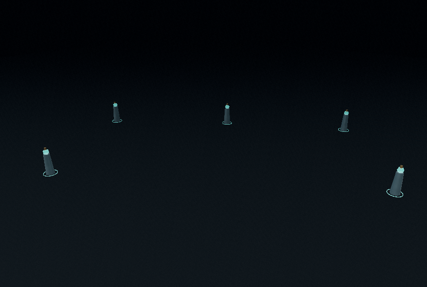
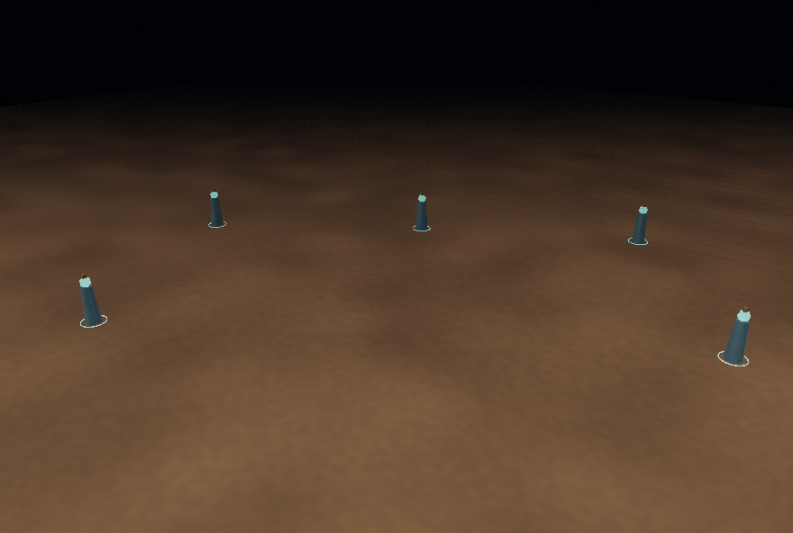

# Nền đất nâu — trước và sau

Cùng camera, exposure 1,2, preset Low và thời điểm mô phỏng 42 giây; không có skill đang chạy. Nền nâu ấm có vân đất procedural tĩnh, roughness 0,98 và metalness 0. Lưới ngắm chuyển sang tông đất và giảm opacity.

Trước:



Sau:



[Ảnh preset High](after-high.png) · [Thảo đang thi triển](nature.png) · [Lớp băng trên đất](frost.png).

| Kiểm tra | Kết quả |
|---|---|
| Build production | PASS, 64 module; cảnh báo Three core 535,18 kB có sẵn |
| Bộ test hiện có | 12 PASS, 0 FAIL |
| Shader thực: bốn preset | Low/Medium/High/Ultra PASS |
| Wet/burn/frost/mud/moss + skill Thảo | Low/High PASS; 18 ảnh/mốc tổng cộng |
| Reset sau Thảo | Khớp từng pixel với baseline Low/High |
| JavaScript/WebGL/shader | 0 error; test cố định có 0 warning |
| UI production không hook | Chọn/cast Thủy/Bóng Tối, Play/MP/Pause PASS |
| Registry và launcher | 15 hệ/21 skill khớp trước sửa; START.bat giữ nguyên byte |
| Tài nguyên cảnh nền tĩnh | Trước/sau cùng 23 geometry, 14 texture; không thêm mesh/texture/pass |

Video production: [trước](before.webm) · [sau](after.webm). Video không có audio. Hai video lấy từ thao tác UI thật, thời gian render có thể khác nhau nên không dùng để so pixel hoặc đo FPS. GitHub có thể yêu cầu tải raw video để xem.

Raw report: [shader/preset/surface](shader-results.json), [production trước](before-production.json), [production sau](after-production.json), [hash và tổng hợp](verification.json). Báo cáo ghi parent commit và `sourceDirty`; hash hai file runtime trong verification xác định đúng nguồn đã chạy trước commit. Một vòng sửa/kiểm thử, không gặp lỗi shader cần sửa tiếp.

Production sau ghi hai warning watchdog khi khởi tạo Hỏa trong SwiftShader: giảm volumetric và giới hạn ngân sách VFX sau 257 ms khởi tạo đồng bộ. Không phải lỗi compile shader; giữ nguyên warning trong báo cáo. Đây không phải phép đo hiệu năng GPU thật. Chưa xác minh Live Preview từ xa, launcher trên Windows thật hoặc chất lượng audio bằng tai.

Tái chạy:

```sh
npm test
npm run dev:test -- --port 5183
# Terminal khác:
python tests/ground_browser.py --output work/ground-browser
npm run observe -- --label after-brown-ground
```

Fixture camera/thời gian chỉ chèn qua route Playwright, không được đưa vào game phát hành. [10 ý tưởng và phạm vi](../../ROUND-GROUND-2026-10-17.md).
