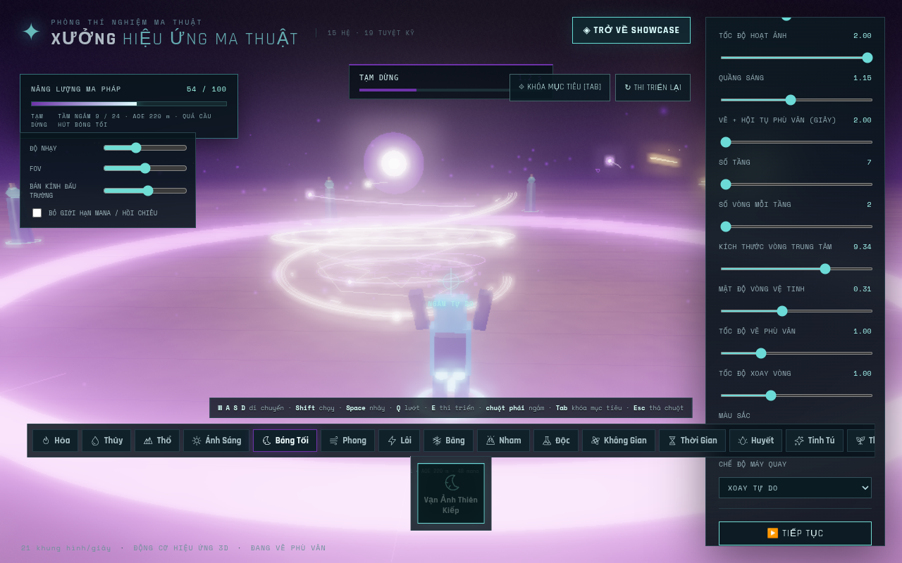
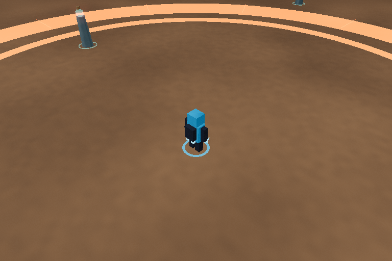
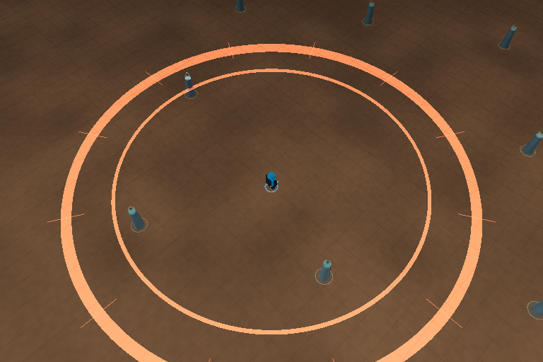
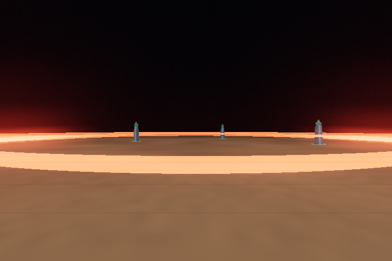
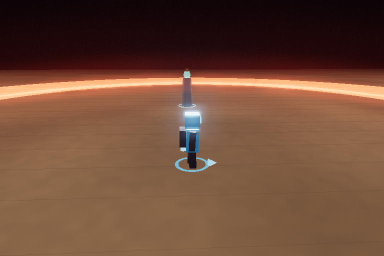
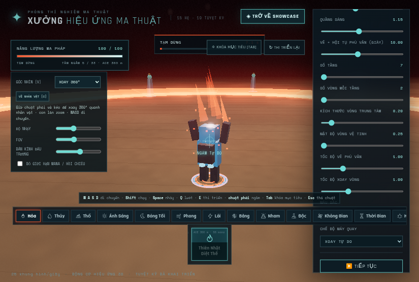

# Camera nhân vật — 18/10/2026

Đã thêm **3/4, tự do kiểu LoL, thứ nhất và xoay 360°**, giữ lựa chọn Theo sau. Mặc định mới là 3/4. Vào **CHẾ ĐỘ CHƠI → GÓC NHÌN** ở khung bên trái; phím **V** chuyển nhanh khi đang điều khiển cảnh.

| Góc nhìn | Điều khiển camera | Di chuyển/ngắm |
|---|---|---|
| 3/4 | Góc chéo cố định theo thế giới, theo vị trí nhân vật; con lăn zoom | WASD theo màn hình; trỏ chuột xuống đất để ngắm |
| Tự do — LoL | Rê mép màn hình hoặc kéo chuột giữa để pan; con lăn zoom; C về nhân vật; Y bật/tắt theo dõi | Camera có thể rời nhân vật; WASD vẫn di chuyển, con trỏ ngắm mặt đất |
| Thứ nhất | Nhấp cảnh để khóa chuột, hoặc giữ chuột phải để nhìn; FOV mặc định75 | Đặt mắt cao1,77m, ẩn thân để không che tầm nhìn; WASD/E như trước |
| Xoay360° | Giữ chuột phải và kéo để xoay ngang đầy vòng, chỉnh cao độ; con lăn zoom | Di chuyển không kéo camera về sau lưng; hướng nhìn độc lập actor |
| Theo sau | Giữ góc thấp quen thuộc và theo vị trí; chuột phải nhìn/con lăn zoom | Giữ lựa chọn cũ và cinematic legacy khi bật |

Space vẫn nhảy, Q lướt, E thi triển, hotbar1–3 giữ nguyên. Đây là camera kiểu LoL; chưa thêm click phải để đi/pathfinding/minimap. Khi cast, nhân vật vẫn đứng yên/giơ hai tay; camera có thể đổi/pan/xoay. Khi pause, camera quan sát được nhưng timeline/pose của skill không chạy. Thời lượng rune10s, active0,5× và fade1,8s giữ nguyên.

## Hình ảnh

Trước — góc thấp sau lưng:

Góc3/4:

Góc LoL:

Góc thứ nhất:

Orbit nhìn từ phía trước:

[Điều khiển trên màn hình hẹp](mobile-controls.png).

## Kiểm chứng

- [Build68module](build.txt) và [24unit](unit.txt) PASS, gồm5ca camera mới. Cảnh báo Three core536,16kB vượt500kB vẫn có.
- [Ma trận125ca](matrix.json): đủ19skill ×5view Low, thêm6skill(FIRE/WATER/SPACE/TIME/SHADOW/NATURE) ×5view High;0JS/WebGL/shader error/warning. Kiểm tra projection/FOV, model visibility, actor/camera transform, bán kính VFX/reticle và cleanup. Đây là render các mốc bằng clock cố định0,05s; không phải125lượt chơi đầy đủ hoặc benchmark GPU native.
- Chuỗi UI thực qua Playwright PASS: chọn menu, xoay đủ vòng và điW không đổi azimuth, kéo chuột giữa, edge pan, C/Y/V, follow, ray ngắm theo cursor/cast context không đổi sau pan, giữ hai tay/vị trí khi đổi view, camera lúc pause không chạy timeline, first-person eye/ẩn thân, Showcase round trip và điều khiển390×844.
- Vòng1 tìm thấy PointerDown.preventDefault chặn compatibility MouseMove khi kéo chuột giữa. Đã dùng PointerMove cho kéo và MouseMove riêng khi pointer lock để không cộng hai lần. [Lượt chưa đạt](pointer-attempt1.json) được giữ; vòng2 và ma trận PASS.
- Sau ma trận, [ca tay cầm mô phỏng trước sửa](gamepad-before.txt) phát hiện chiều nhìn ngang bị đảo; [sau sửa](gamepad-after.txt) PASS. Thay đổi cuối chỉ đổi dấu trục ngang; full unit/build và bản production cuối xác minh sau sửa. Không gọi đây là kiểm thử tay cầm phần cứng. [Hash trước/sau và bundle](tested-source.json) ghi riêng để đối chiếu.
- [Bảo toàn](preservation.json):983file nguồn/asset/dependency/launcher và các block registry/cinematic/rune/cast/brown-ground không đổi. Model/hai tay, toàn15hệ/19skill, MP/cooldown/audio/timing giữ nguyên. Một renderer/RAF/camera hiện hữu, không có backend/API/database/env/service mới.

## Production và giới hạn

[Video MP4](production.mp4) · [Kết quả production](production.json) · [Thông tin video](video.json). Bản build thật không chèn hook, preset Low/DPR0,75:13ảnh bao quát4view mới/TheoSau, pan/follow LoL, pointer lock/eye view, quay đủ vòng, cast/pause/đổi view/Showcase round trip PASS,0console/page error/warning. API thả pointer lock đã đạt; không dùng phím Esc giả lập trong lượt cuối. Video giữ toàn bộ frame/thời lượng WebM, không audio/FPS GPU/LivePreview. Native Windows/GPU và Esc vật lý chưa được kiểm thử.

Trong Chromium headless, phím Esc giả lập bị kẹt sau khi khóa chuột; chỉ cây tiến trình ghi hình đó được dừng, giữ ảnh/video raw ở work/camera-modes/production. Lượt sau dùng API công khai document.exitPointerLock() thay cho phím Esc giả lập; không chèn hook vào source production. Không gọi lượt bị kẹt là PASS hoặc coi API exit là bằng chứng Esc vật lý hoạt động. Mã runtime không đổi vì giới hạn automation này.

Để ZIP chứa video camera mới mà vẫn dưới giới hạn100MiB của GitHub, hai WebM lịch sử nền đất được giữ nguyên trong repo và dẫn bằng URL trong báo cáo của ZIP; ARCHIVE_MEDIA_LINKS.json liệt kê các liên kết. Mã game/asset hiện tại và các ảnh/số đo lịch sử vẫn được đóng gói.

[10ý tưởng và phạm vi đã chọn](../../ROUND-CAMERA-2026-10-18.md). Vòng sau có thể thêm minimap/bookmark, camera click-to-move nếu gameplay được chọn, hoặc tách rõ UI camera Showcase. HP/Boss/world và các draft AAA khác chưa hoàn tất. Giữ Draft PR#1, không merge main hoặc deploy công khai.
