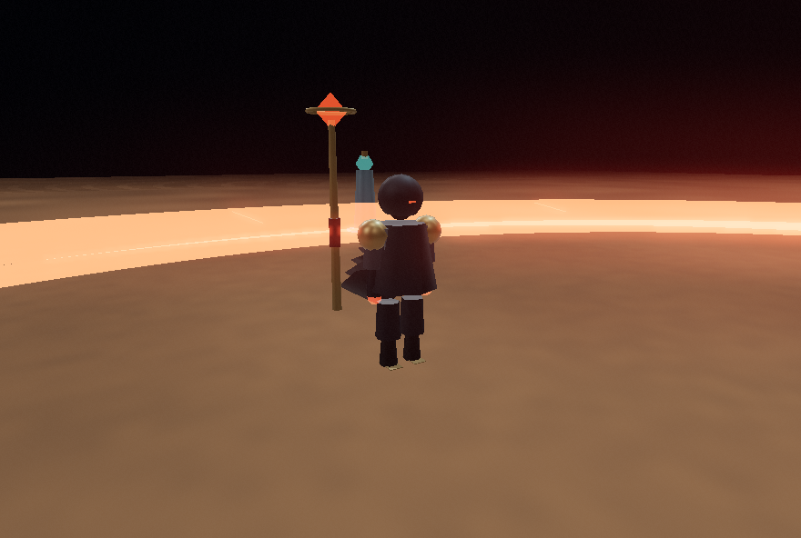
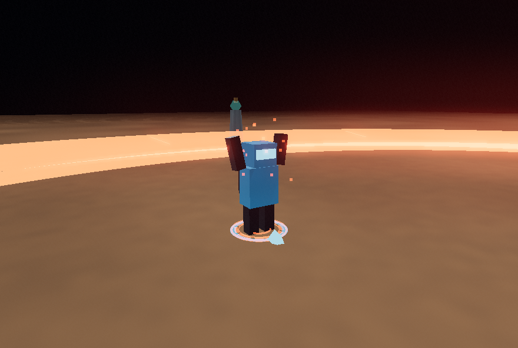
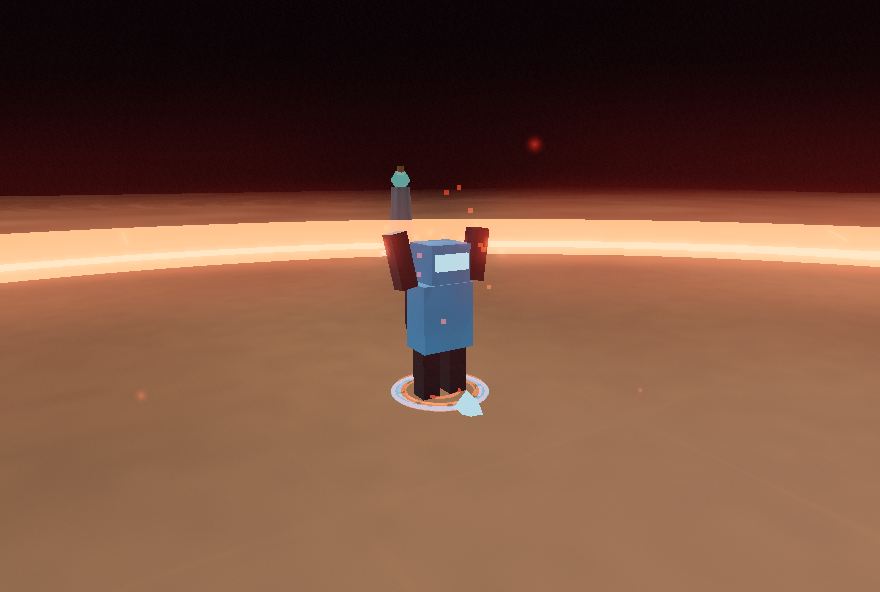
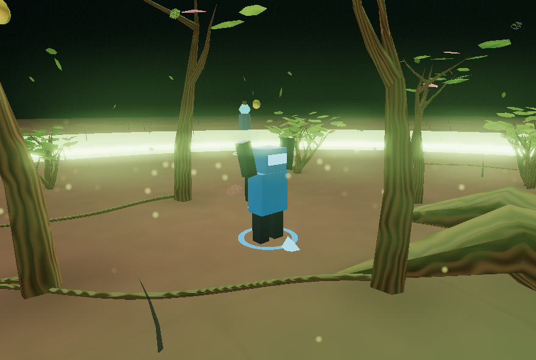
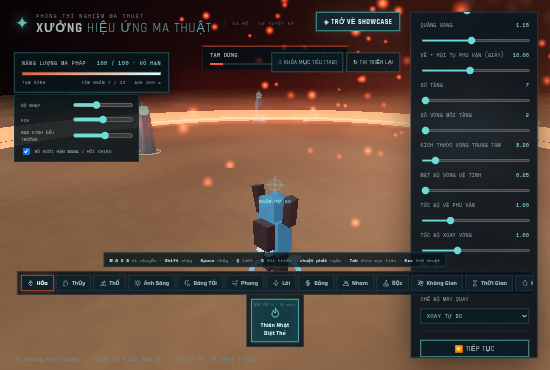

# Cyber Bot, tư thế hai tay và timeline thi triển

Model **Cyber Bot** mặc định trong ZIP người dùng thay pháp sư cũ. Bot đứng yên, giơ hai tay lên trên đầu suốt charging/channeling/active; camera vẫn xoay tự do. Mặc định rune **8,5s vẽ +1,5s hội tụ =10s**. Active của mọi skill chạy **0,5×**, kéo dài gấp đôi; các marker thiết kế, MP/cooldown và audio score nội bộ không bị viết lại. Fade rune tiếp tục **1,8giây simulation** từ lúc hiệu ứng thật hiển thị, không bị nhân thành3,6s.

## Kiểm chứng

- [Build](build.txt):67module PASS; [11file unit](unit.txt) PASS, gồm3ca mới cho timeline/pose/input lock. Cảnh báo chunk Three core536,16kB vượt500kB vẫn còn.
- [Ma trận](matrix.json):19Low+19High,228mốc render và38cleanup,0JS/WebGL/shader error/warning. Chạy vòng main thật với clock cố định0,05s; không render từng bước CPU trung gian. Vô hạn MP, hit-stop/slow motion tắt trong phép đo thời lượng. Hai tay trên đỉnh đầu, vị trí/velocity giữ nguyên khi bấm WASD/nhảy/lướt/ngắm/khóa mục tiêu; di chuyển phục hồi sau cleanup.
- [Lifecycle](lifecycle.json): pause/hit-stop đóng băng hai clock; slow0,25 kết hợp playback0,5; Time xuất hiện trễ; audio thật dùng rate0,5/0,125/pause0 và finale duy nhất; reset/rapid selection/slider snapshot PASS. [Hồi quy rune](rune-regression.json), [Medium](medium.json) và [Ultra](ultra.json) đại diện PASS. Các lượt này có2warning watchdog lúc khởi tạo/reset High trên SwiftShader, không có JS/WebGL/shader error.
- [Bảo toàn](preservation.json):979file nguồn/asset/dependency/launcher không đổi; registry/cinematic/rune profile, MP/cooldown/score của19skill khớp snapshot trước sửa. [Hash runtime đã test](tested-source.json). Nguồn model/hash ZIP tại assets/sources/cyber-bot-provenance.json; code mẫu rút trích được giữ để đối chiếu. Không nhập renderer/RAF/controller/audio/CDN của demo.

| Skill | Active gốc (s) | Mục tiêu mới (s) | Đo Low/High (s) |
|---|---:|---:|---:|
| FIRE-01 | 9.84 | 19.68 | 19.70 |
| WATER-01 | 17.00 | 34.00 | 34.05 |
| EARTH-01 | 18.00 | 36.00 | 36.05 |
| LIGHT-01 | 17.20 | 34.40 | 34.45 |
| SHADOW-01 | 17.00 | 34.00 | 34.05 |
| WIND-01 | 20.25 | 40.50 | 40.55 |
| LIGHTNING-01 | 17.20 | 34.40 | 34.45 |
| ICE-01 | 16.00 | 32.00 | 32.05 |
| MAGMA-01 | 9.76 | 19.52 | 19.55 |
| MAGMA-02 | 9.94 | 19.88 | 19.90 |
| MAGMA-03 | 9.68 | 19.36 | 19.40 |
| POISON-01 | 16.00 | 32.00 | 32.05 |
| SPACE-01 | 19.20 | 38.40 | 38.45 |
| TIME-01 | 18.00 | 36.00 | 36.05 |
| BLOOD-01 | 17.40 | 34.80 | 34.85 |
| ASTRAL-01 | 9.82 | 19.64 | 19.70 |
| ASTRAL-02 | 9.96 | 19.92 | 19.95 |
| ASTRAL-03 | 9.68 | 19.36 | 19.40 |
| NATURE-01 | 18.00 | 36.00 | 36.05 |

Tổng pre-cast đo10,00s cho mọi hàng. Sai số active tối đa0,06s gồm bước clock0,05s và guard cleanup. Đây là thời gian simulation ở speed1, không phải thời gian thực/FPS trên GPU người chơi. Pause/hit-stop/slow motion làm dài thời gian thực theo thiết kế.

## Bản ghi production

[Video MP4](production.mp4) · [Kết quả UI không hook](production.json) · [Thông tin video](video.json). Mặc định castTime10/speed1, presetLow, DPR0,5 để kiểm thử trên SwiftShader. Khởi động, model idle/cast, hội tụ, active, camera orbit, aftermath, kết thúc, đi lại và reset PASS;0console/page error. Video không audio và không phải Live Preview/FPS GPU native.

## Phạm vi và giới hạn

- Timeline được chụp theo mỗi cast; slider thời gian/tốc độ nghi thức điều chỉnh lần cast tiếp theo. Reset đưa mặc định về10s. Active vẫn chịu slider tốc độ mô phỏng hiện hữu.
- Model procedural từ mã người dùng; không phải GLB/skinned asset. Nâng vai khi giơ tay và hạ thân0,09m để chân chạm đất. Aura lam/mũi tên là marker hướng của model; vòng phép theo nguyên tố/hạt/đèn vẫn fade. HP/hurt/death, drone/astronaut selection và parkour trong demo chưa tích hợp.
- Audio bank/cue gốc giữ nguyên, runtime đi theo playback mới; pitch cũng đổi như engine hiện hành, chưa có time stretching giữ cao độ. File WAV tham chiếu offline dùng timeline tác giả gốc, không phải bản ghi browser mới.
- Một fixture lifecycle ban đầu gọi biến config ngoài module, đã sửa fixture và rerun đủca PASS. Lượt production đầu chạy cùng ma trận bị timeout180s trên SwiftShader (0console error); raw được giữ tại work/character-cast/production, [metadata lượt timeout](production-attempt1.json). Lượt ghi riêng sau đó PASS như trên. Không gọi lượt timeout là PASS.
- Chỉ Chromium/ANGLE/SwiftShader. Chưa kiểm Windows/GPU native hoặc Live Preview tương tác từ xa. Không deploy công khai, không dùng dịch vụ trả phí; Draft PR#1 không merge main.

[10ý tưởng/chọn3 và acceptance](../../ROUND-CHARACTER-CAST-2026-10-17.md). Backlog tiếp: time stretching giữ pitch nếu cần, animation hurt/death/HP và các trạng thái gameplay; menu model/IK/cinematic mới chỉ triển khai khi phạm vi được chọn.
