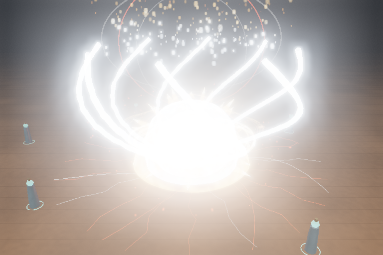

# Thu gọn Hỏa, bảo toàn các skill còn lại

Danh mục hiện tại: **15 hệ, 19 skill**. Hỏa chỉ còn **FIRE-01 — Thiên Nhật Diệt Thế**. Hai skill Hỏa khác đã được gỡ khỏi registry, mã dựng/cập nhật VFX, nhịp rung/cinematic và score âm thanh riêng. UI/hotbar/phím tắt/Audio Lab lấy danh sách từ registry nên chỉ còn một mục Hỏa. Không có cấu hình combo/passive/buff riêng cho hai mục này trong mã được khảo sát.

Giữ shader lửa, plasma, ember/khói, icon Hỏa và bank cue dùng chung vì FIRE-01 còn sử dụng. Đã gỡ12tệp riêng:4WAV (bản nguồn và mirror),2report,2biểu đồ cường độ và4ảnh so sánh. Các record/tài liệu còn tham chiếu hai skill đã được dọn; bản ZIP cũng được đóng gói lại.

Tên/mô tả/chỉ số/cinematic/rune/audio/MP/cooldown của19skill còn lại khớp dữ liệu trước sửa. FIRE-01 vẫn có AOE300m, pace1,04, count96, cost55MP, hồi23,5giây và hit-stop0,135giây; các con số này được **đối chiếu**, không điều chỉnh. Công thức cooldown/MP, đồng hồ/slow-motion/hit-stop và các hàm shader/particle lửa được kiểm hash giữ nguyên. Không sửa mô hình/animation/hit logic trong37tệp nguồn còn lại;938publicasset còn dùng giữ nguyên byte.

Một số tạo hình/seed trước đây dùng vị trí skill trong mảng. Giữ seed gốc theo ID khi thu gọn UI để không làm đổi rune/camera/particle của các hệ khác; lookup/cooldown/UI tiếp tục dùng chỉ số danh sách hiện tại. Đây là sửa tham chiếu cần thiết cho thao tác xóa, không phải thiết kế lại skill.

| Kiểm chứng | Kết quả |
|---|---|
| Snapshot19skill | Tên, mô tả, config, cinematic, rune profile, MP, cooldown, score khớp trước sửa |
| Browser Chromium/SwiftShader | 19skill Low × charging/impact/aftermath, thêm FIRE-01 High ×3mốc:60ảnh trước/sau khớp từng pixel |
| JavaScript/Three.js/WebGL/shader | 0error/0warning trong ma trận bảo toàn |
| Build | PASS64module, cảnh báo Three core535,18kB có sẵn |
| Unit | 13PASS, gồm fingerprint bảo toàn19skill |
| Production observation | Chọn/cast Thủy/Bóng Tối, Play/MP/Pause đạt,0error/0warning |
| Production menu/hotkey/Lab | Xem [báo cáo kiểm tra trực tiếp](production.json) |
| Tham chiếu đã gỡ | [0match trong source/UI/audio metadata/docs/tests/tên file, gồm dist](reference-audit.json) |

Ảnh FIRE-01 trước và sau cùng camera/seed/thời điểm:




[Charging](charging.png) · [Aftermath](aftermath.png) · [High impact](high-impact.png) · [Thủy giữ nguyên](water.png) · [Tinh Tú giữ nguyên](astral.png) · [Menu Hỏa](fire-menu.png) · [Play Mode](fire-play.png) · [Video production sau sửa](production.webm).

[Hash/60cặp ảnh/module/asset](preservation.json) · [Raw browser](browser-results.json) · [Raw production observation](observation.json). Toàn bộ60ảnh trước và60ảnh sau nằm trong scratch `work/fire-trim` của môi trường kiểm thử; chỉ ảnh chọn lọc được phân phối. Video không audio; SwiftShader không phải benchmark GPU thật. Chưa xác minh Live Preview từ xa hoặc chạy launcher trên Windows thật.

Fixture menu vòng đầu giữ focus ở nút chuyển chế độ vì canvas không focusable, khiến E bị guard bàn phím bỏ qua. Đã sửa fixture bằng blur nút trước khi gửi phím; không sửa keyboard logic game. Raw lần đầu giữ ở scratch, lần xác minh lại được lưu trong production.json. Mã runtime chỉ có một vòng thay đổi.

Một số báo cáo lịch sử được lọc hàng/tham chiếu của các skill đã gỡ và có ghi chú `historicalRecordNote`; không đổi số đo của hàng còn lại hay gọi số tổng lịch sử là kết quả mới. Snapshot gốc trước thu gọn vẫn ở commit3273606.

Tái chạy:

```sh
npm test
npm run build
npm run dev:test -- --port 5183
# Terminal khác: ghi baseline trước khi sửa; sau sửa truyền đường dẫn baseline.
python tests/skill_preservation_browser.py --output work/before
python tests/skill_preservation_browser.py --output work/after --baseline work/before
npm run preview -- --host 127.0.0.1 --port 4184
python tests/fire_menu_production.py --output work/fire-menu
```

Fixture baseline không được đưa vào runtime game. Các hệ khác không được nâng cấp hoặc sửa thiết kế trong nhóm này. Các nhiệm vụ đồ họa lớn còn dang dở vẫn ở roadmap.
