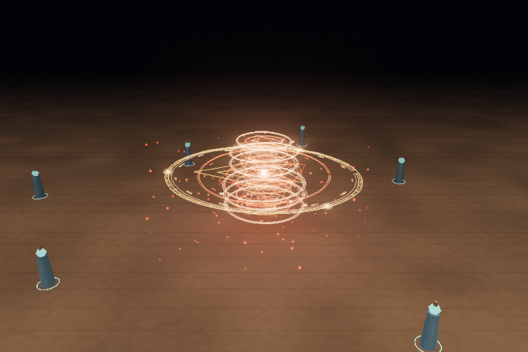
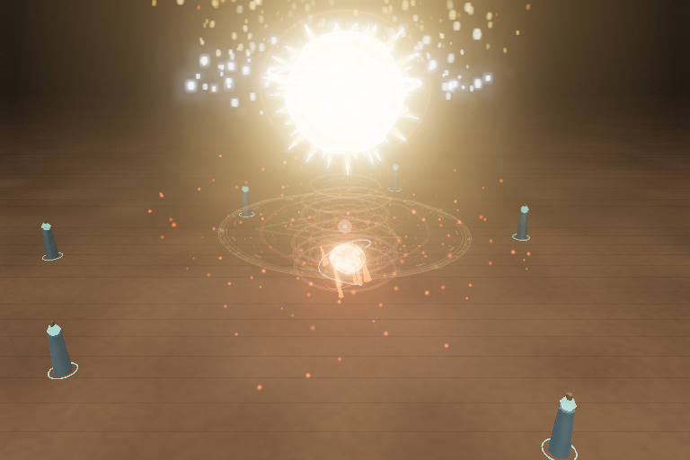
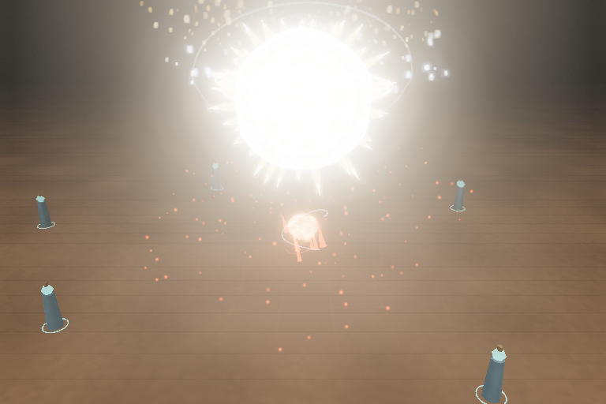

# Phù văn mờ dần khi skill xuất hiện

Áp dụng cho **15 hệ / 19 skill**: phù văn chung giữ hình vẽ khi charging/channeling, rồi mờ liên tục trong **1,8giây mô phỏng** khi nhóm hiệu ứng của skill được bật hiển thị. Skill có nhóm hiệu ứng xuất hiện trễ được chờ, bỏ qua root placeholder trống. Hết fade, vòng/glyph/vệ tinh/hạt/đèn đều tắt và group ẩn hẳn; impact hay bật lại tùy chọn không làm phù văn hiện lại. Recast tạo vòng mới.

FIRE-01 khi vừa xuất hiện:



Sau0,9giây fade:



Sau1,85giây fade:



[Bản trước sửa ở cùng mốc active1,9giây](before.png) · [Thời Gian sau khi nhóm hiệu ứng đã xuất hiện và fade hoàn tất](time-finished.png) · [Video production với phù văn bật](production.mp4).

Các ảnh FIRE-01 trước/sau1,9giây dùng cùng camera, preset Low, seed và thời điểm mô phỏng. Đây là thay đổi phù văn có chủ đích; VFX của đòn đánh vẫn theo timeline/cấu hình cũ. Mốc fade của fixture bắt đầu ở active0,05giây; Thời Gian có nhóm hiệu ứng ẩn đến1,85giây nên fixture ghi bắt đầu ở1,9giây. Runtime bắt đầu ở frame hiển thị thật của nhóm.

| Kiểm tra | Kết quả |
|---|---|
| Ma trận WebGL | 19skill Low +19skill High,192mốc: đầu/giữa/cuối fade và sau impact |
| Chuyển opacity | Giảm qua các mốc; sau hạn cuối opacity vật liệu/cường độ hạt/đèn bằng0, group ẩn |
| Skill xuất hiện trễ | Thời Gian chờ nhóm attack bật hiển thị; không fade ở root trống |
| Preset bổ sung | Medium/Ultra FIRE-01 đạt |
| Lifecycle | Pause/resume, hit-stop, slow motion0,25, toggle không hiện lại, recast và auto-repeat/cleanup đạt |
| Cấu hình19skill | Source audit giống hệt checkpoint trước; fingerprint config/cinematic/rune profile/MP/cooldown/audio đạt |
| Build/unit | Build65module,16test đạt; cảnh báo Three core535,18kB có sẵn |
| Lỗi | Ma trận0JS/WebGL/shader error và0warning; xem raw lifecycle/production riêng |

[Ma trận](matrix.json) · [Lifecycle](lifecycle.json) · [Production bật phù văn](production.json) · [Hash nguồn và cấu hình](preservation.json) · [Thông tin video](video.json).

Lifecycle riêng có2warning watchdog ở lần khởi tạo FIRE-01: giảm volumetric và giới hạn ngân sách sau274ms trên SwiftShader. Không phải lỗi shader; không xóa warning khỏi báo cáo. Production bật phù văn0error/0warning. Không dùng các phép đo/ảnh này để khẳng định FPS GPU native.

Video MP4 được chuyển từ WebM Playwright; giữ nguyên2.806frame,112,24giây, không có audio.25fps là tốc độ mã hóa video, không phải FPS render của game. Video ghi thao tác UI production thật, không có hook; ảnh/ma trận dùng fixture điều khiển mô phỏng. Raw trước/sau và bản WebM gốc giữ ở scratch `work/rune-fade` của môi trường; bản chọn lọc được phân phối trong thư mục này. Chưa xác minh Live Preview từ xa hoặc launcher Windows thật.

Không thêm renderer, RAF, texture, mesh hoặc timer. Cấu hình/thời điểm đòn đánh và âm thanh giữ nguyên; chỉ chuyển tiếp hiển thị phù văn chung đổi theo yêu cầu mới. [Phạm vi và10ý tưởng](../../ROUND-RUNE-FADE-2026-10-17.md).

Tái chạy:

```sh
npm test
npm run dev:test -- --port 5183
# Terminal khác:
python tests/rune_fade_browser.py --output work/rune-matrix
python tests/rune_fade_browser.py --lifecycle-only --output work/rune-lifecycle
npm run observe -- --label rune-fade --runes --hold-seconds 2
```

Đổi thời lượng chung tại `RUNE_RELEASE_FADE_SECONDS` trong `src/rune-fade.js`. Không sửa các thông số skill hoặc các draft gate cũ để điều chỉnh fade này.
